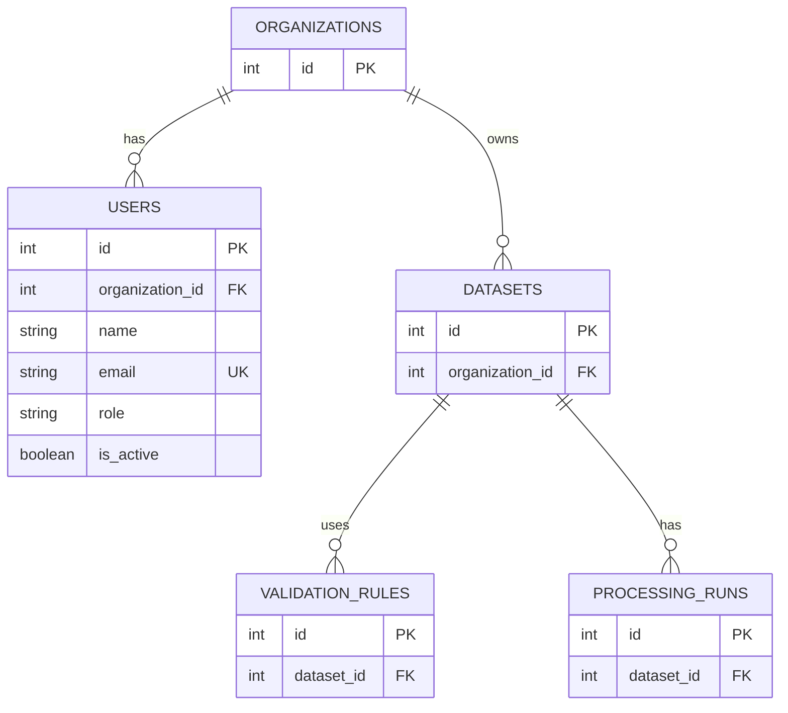

# DataPulse Enterprise — Database Schema

## 1. Overview

DataPulse Enterprise uses PostgreSQL to store organization details, user information, datasets, validation rules, and processing run records.

## 2. Database Tables

### Organizations

Stores organization information.

- `id` — Primary key
- Other organization fields — Refer to `app/models/organization.py`

### Users

Stores user information and organization membership.

- `id` — Primary key
- `organization_id` — Foreign key referencing `organizations.id`
- `name` — User name
- `email` — Unique email address
- `role` — User role
- `is_active` — Account status

### Datasets

Stores dataset metadata.

- `id` — Primary key
- Organization reference and dataset fields — Refer to `app/models/dataset.py`

### Validation Rules

Stores validation rule definitions.

- `id` — Primary key
- Rule fields and related references — Refer to `app/models/validation_rule.py`

### Processing Runs

Stores information about dataset processing runs.

- `id` — Primary key
- Dataset reference and run fields — Refer to `app/models/processing_run.py`

## 3. Entity Relationship Diagram

## 4. Keys and Relationships

- **Primary Key (PK):** Uniquely identifies each record.
- **Foreign Key (FK):** Links a record to another table.
- **Unique Key (UK):** Prevents duplicate values for a field such as user email.

## 5. Verification Note

The diagram represents the intended initial data model. Verify each column, foreign key, and relationship against the SQLAlchemy model definitions before treating this diagram as the final database specification.

## 6. Database Configuration

Database connection settings are loaded from the backend environment configuration. Do not store passwords or other secrets in this documentation.