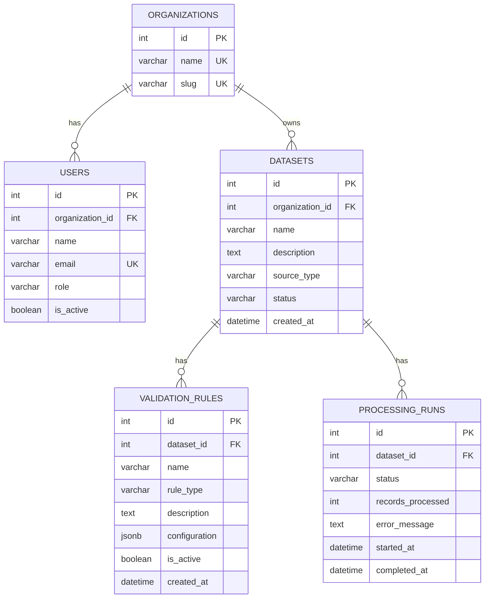

# DataPulse Enterprise — Database Schema

## 1. Overview

DataPulse Enterprise uses PostgreSQL to store organization information, users, datasets, validation rules, and processing runs.

Database name: `datapulse_db`

## 2. Database Tables

### 2.1 Organizations

Stores organization information.

| Column | Data Type | Constraints |
|---|---|---|
| `id` | Integer | Primary key |
| `name` | VARCHAR(150) | NOT NULL, UNIQUE |
| `slug` | VARCHAR(100) | NOT NULL, UNIQUE, INDEXED |

### 2.2 Users

Stores user information and organization membership.

| Column | Data Type | Constraints |
|---|---|---|
| `id` | Integer | Primary key |
| `organization_id` | Integer | Foreign key to `organizations.id`, NOT NULL, INDEXED |
| `name` | VARCHAR(150) | NOT NULL |
| `email` | VARCHAR(255) | NOT NULL, UNIQUE, INDEXED |
| `role` | VARCHAR(50) | NOT NULL |
| `is_active` | Boolean | NOT NULL, default TRUE |

The organization foreign key uses `ON DELETE CASCADE`.

### 2.3 Datasets

Stores dataset metadata.

| Column | Data Type | Constraints |
|---|---|---|
| `id` | Integer | Primary key |
| `organization_id` | Integer | Foreign key to `organizations.id`, NOT NULL, INDEXED |
| `name` | VARCHAR(150) | NOT NULL |
| `description` | TEXT | Nullable |
| `source_type` | VARCHAR(50) | NOT NULL, default `file` |
| `status` | VARCHAR(30) | NOT NULL, default `pending` |
| `created_at` | DATETIME | NOT NULL, default UTC timestamp |

The organization foreign key uses `ON DELETE CASCADE`.

### 2.4 Validation Rules

Stores validation rule definitions and their configuration.

| Column | Data Type | Constraints |
|---|---|---|
| `id` | Integer | Primary key |
| `dataset_id` | Integer | Foreign key to `datasets.id`, NOT NULL, INDEXED |
| `name` | VARCHAR(150) | NOT NULL |
| `rule_type` | VARCHAR(50) | NOT NULL |
| `description` | TEXT | Nullable |
| `configuration` | JSONB | NOT NULL, default empty JSON object |
| `is_active` | Boolean | NOT NULL, default TRUE |
| `created_at` | DATETIME | NOT NULL, default UTC timestamp |

The dataset foreign key uses `ON DELETE CASCADE`.

### 2.5 Processing Runs

Stores dataset processing run information.

| Column | Data Type | Constraints |
|---|---|---|
| `id` | Integer | Primary key |
| `dataset_id` | Integer | Foreign key to `datasets.id`, NOT NULL, INDEXED |
| `status` | VARCHAR(30) | NOT NULL, default `pending` |
| `records_processed` | Integer | NOT NULL, default 0 |
| `error_message` | TEXT | Nullable |
| `started_at` | DATETIME | NOT NULL, default UTC timestamp |
| `completed_at` | DATETIME | Nullable |

The dataset foreign key uses `ON DELETE CASCADE`.

## 3. Entity Relationship Diagram

## 4. Keys and Relationships

- **Primary Key (PK):** Uniquely identifies each record.
- **Foreign Key (FK):** Connects records between related tables.
- **Unique Constraint (UK):** Prevents duplicate organization names, organization slugs, and user email addresses.
- **Indexes:** Improve lookup performance on the indexed ID and foreign key columns.
- **Cascade Delete:** The database foreign keys specify `ON DELETE CASCADE` for organization and dataset relationships.

## 5. Database Configuration

Database connection settings are loaded from the backend environment configuration.

Credentials and other secrets must not be committed to Git or included in this documentation.

## 6. Verification Notes

The schema above documents the current SQLAlchemy model definitions and the `configuration` column added to the PostgreSQL database.

Verify the live database schema against these definitions before using this document as the final database specification.

The SQLAlchemy `create_all()` operation creates missing tables but does not automatically migrate existing tables when model definitions change.
